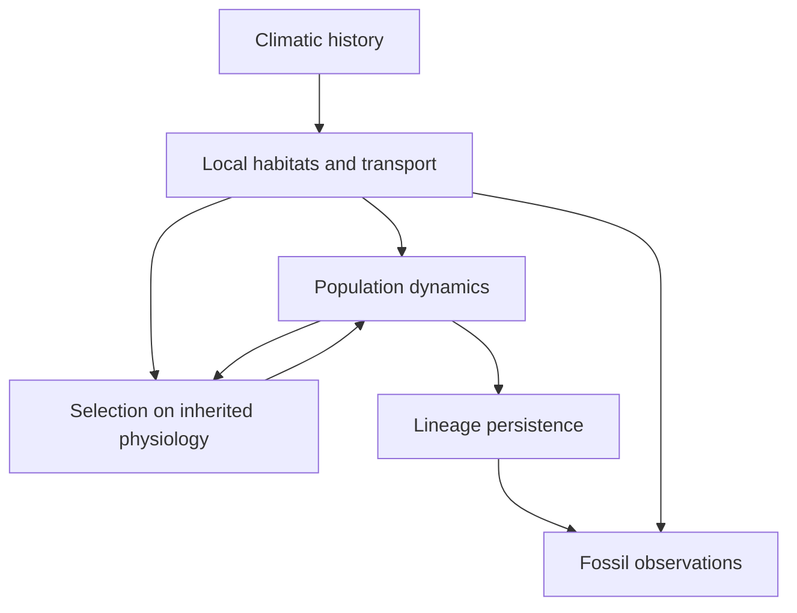

# Could adaptation to Snowball Earth make the thaw more lethal?

## A simulation proposal for selective lineage extinction during the Sturtian, approximately 730–650 Ma

**Prepared for:** Barry W. Brook and the Claude/Codex agents developing EPRP  
**Date:** 20 October 2026, Australia/Hobart  
**Status:** Developed proposal for critical consideration; no primary simulation campaign or historical extinction inference has been performed.  
**Novelty assessment:** A potentially original quantitative test of a specific deep-time extinction mechanism. Its conceptual and methodological ingredients have important precedents, identified below. The bounded search does not establish absolute priority.  
**Suggested destination:** `ideas/2026-10-20-sturtian-adaptation-extinction-proposal.md`; let the repository agents decide whether it warrants a new register entry.  
**Repository context:** `BWBrook/eprp`, read at commit [`3d432f0aabef19c9d8e07928aa93e14fe83e06a8`](https://github.com/BWBrook/eprp/tree/3d432f0aabef19c9d8e07928aa93e14fe83e06a8). The repository was used as context through read operations. This is a standalone proposal, not a change to its registers or current work allocations.

---

## 1. The proposal in one page

### Central question

**Can heritable adaptation during prolonged glaciation reduce the persistence of the same founding lineages after deglaciation, and under what conditions does that later cost outweigh the survival benefit gained during the glaciation?**

Study this question in early eukaryotic phototrophs occupying marine and non-marine refugia through the Sturtian climatic episode. The historical application is approximately 730–650 million years ago. All simulated outcomes remain well before the Ediacaran. Modern physiological experiments provide comparative constraints; the project does not simulate modern evolution or extend into the Ediacaran radiation.

The proposed mechanism has four steps. A lineage reaches a viable glacial habitat. Selection changes its inherited physiology while it persists there. Deglaciation changes the habitat and the routes to alternative habitats. Some physiological changes that were useful during the cold interval then reduce establishment or persistence in the available postglacial environments. Migration, acclimation, retained genetic variation and dormant propagules can interrupt that sequence. Whether the sequence actually causes extra global lineage extinction is the research question.

The important comparison follows **identical preglacial founding ancestries through complete environmental histories**. The principal pair allows or suppresses heritable change during the Sturtian interval, then allows the same evolutionary processes during the final thaw and aftermath in both arms. This tests the consequences of earlier evolution while allowing subsequent rescue. Simply counting deaths after the thaw would be misleading: an evolving treatment could save more lineages during the freeze and consequently have more lineages available to die afterwards. A separate simulated common-garden experiment compares ancestral and evolved physiological repertoires to establish whether there is an inherited performance cost.

### Why it deserves investigation

This would connect macroevolutionary survival to the biological consequences of a particular sequence of planetary environments. It could explain why a habitat that preserves life during an extreme episode fails to preserve the same evolutionary lineages through the subsequent transition. It would also establish when that intuition fails: broad physiological tolerance or rapid rescue might make adaptation beneficial throughout.

The project is timely because three relevant research strands can now be connected: an explicit Snowball ecosystem-relocation hypothesis [1,2]; a published alternative in which the Sturtian contains repeated Snowball–hothouse cycles [3,4]; and increasingly explicit physiological and fossil resources [7–17]. None of those sources establishes a deglacial extinction caused by prior adaptation.

### What is proposed as new

The contribution would be a **Sturtian-specific, mechanistically constrained test of the sign and magnitude of the whole-episode survival effect of glacial adaptation**, with its dependence on viable habitat pathways and climatic ordering. It would estimate additional founding-lineage loss attributable within the model to allowing earlier physiological evolution, then use diagnostic experiments to distinguish inherited performance from its demographic and ecological consequences.

The intended result is a set of interpretable boundary conditions, not a claim that all Snowball survivors became cold specialists. In particular, the project must allow the answer that deglaciation was ordinarily slow enough, or refugia sufficiently connected, for microbial-scale evolutionary and geographic rescue to remove the proposed liability.

### Recommended first deliverable

A theory paper supported by a reproducible simulation experiment and a bounded empirical discrimination analysis. Historical estimation of a Sturtian extinction fraction is conditional on a later data-support assessment. The available fossil archive is useful, but the source audit in Section 10 does **not** justify promising such an estimate now.

The minimum worthwhile result is a defensible answer to: **when does evolution that helps during the freeze become harmful over the full episode, if ever?**

---

## 2. Scope, biological units and relation to EPRP

### 2.1 Temporal boundary

Use an illustrative initialization near 730 Ma, followed by Sturtian onset near 717 Ma, the ensuing climatic history, and the immediate aftermath of final deglaciation near 660 Ma. All intervention arms share the preglacial burn-in. Register the surviving founding cohort immediately before glacial onset and branch treatments there; record any earlier filtering separately. Published age models differ; use their documented constraints and alternative correlations rather than fixing every transition to one nominal age [3,5,9].

Prespecify post-deglacial endpoints at 0.01, 0.1, 1 and 5 Myr after completion of the final deglacial transition. Use the 5 Myr endpoint for the principal whole-episode comparison when it falls within the study interval, and retain earlier endpoints to distinguish transient failure from durable loss. Climatic-history contrasts must use the same elapsed time after final thaw; any truncation changes the target quantity and must be reported separately. Stop all simulations by 650 Ma. If a chronological scenario places another glacial onset within the observation window, either truncate that window explicitly or label the additional forcing as a separate scenario.

There is no need to include the Marinoan termination, Ediacaran organisms or Cambrian diversification. A historical background screen extending into the preceding Tonian can help describe the initial biota; it is not an invitation to expand the simulation into a complete Proterozoic history.

### 2.2 Biological population

The first implementation should represent **early eukaryotic phototroph lineages with different thermal physiologies and habitat affinities**. Green and red algal affinities are useful motivation, but ambiguous fossil assignments should not be converted into precise physiological classes. Include cyanobacteria as ecological competitors or environmental background where needed, rather than making the first model encompass every microbial metabolism.

Exclude animals, land plants, diatoms and other demonstrably inappropriate modern assemblage components from the historical community. Modern organisms can inform comparative physiological distributions without being placed in the simulated Cryogenian biosphere.

Use an immutable identifier for each founding ancestry. Its descendants may change physiology and occupy different habitats while retaining that ancestry identifier. The primary response is persistence of those ancestries. It is **not automatically a species-extinction percentage**. Fossil morphotaxa, biological species, ecological strategies and founding ancestries are different units and require explicit mappings before comparison.

### 2.3 Distinction from existing EPRP entries

The contextual register contains adjacent questions. Their relationship should be acknowledged rather than creating an apparently independent duplicate.

| EPRP entry | Shared ground | Proposed additional target here |
| --- | --- | --- |
| Q-015, thermal niche evolution | Whether evolving physiology affects survival under climate change | Whether adaptation to an earlier state creates a later liability, and whether the liability reverses the net survival benefit across the entire episode |
| Q-007 and Q-009, biological history and ecological memory | Past conditions alter later responses | A specified inherited physiological mechanism, separated experimentally from demographic carryover and environmental persistence |
| Q-020 and B-008, geographic insurance and refugia | Spatial refugia can preserve lineages | Whether survivors can pass through a complete sequence of physiologically compatible habitats as glacial refugia disappear or change |
| Q-029, isolation and reconnection | Ordering can affect enduring diversity | The interaction of climate-state ordering with heritable physiology, using separate controls for geographic change |
| Q-043 and Q-050, evolutionary futures and evolving capacity | Survivor properties influence subsequent possibilities | Persistence through the Sturtian aftermath, without requiring a claim about later Ediacaran innovations |

These are thematic overlaps. Repository agents should decide whether this is best treated as a focused development linked to Q-015/Q-009 or as a separate blue-sky entry. Its strongest justification is the specific Earth-history problem and discriminating experiment, not the age of the rocks alone.

---

## 3. Prior work: the novelty claim must survive these comparisons

### 3.1 Closest studies

| Prior work | What is already established or proposed | What this project would need to add |
| --- | --- | --- |
| Hoffman 2025 and 2026 [1,2] | Explicit hypotheses of polar/alpine biomes relocating during Snowballs and surviving their aftermaths, including return to mountain habitats | Quantify the demographic feasibility and consequences of inherited physiological change across those transitions; credit this conceptual precedent |
| Stoeck et al. 2007 [27] | Earlier scenarios connecting contrasting cold/hot selection filters, persistent refugia and protistan lineage survival | A dynamic extinction experiment; modern community phylogenies in that study do not establish the physiological history of Cryogenian ancestors |
| Minsky et al. 2026; ICEBOX [3,4] | A carbon–climate model proposing repeated Snowball–hothouse states during the Sturtian | Organisms, local exposures, evolution, ancestry persistence and extinction; the existing code supplies a forcing framework, not those biological processes |
| Bowyer et al. 2023 and Zhang et al. 2025 [5,6] | Post-Sturtian environmental reconstruction and modelling, including redox and nutrient changes | Distinguish direct environmental filtering from inherited physiological effects without treating either paper as a measured extinction history |
| Gomulkiewicz and Holt 1995 [18] | Coupled adaptation and population dynamics explaining evolutionary rescue | An Earth-history application involving sequential environments and persistent spatial lineages; evolutionary rescue itself is established theory |
| Marrec and Bank 2023 [17] | Stochastic rescue in periodic and quasi-periodic environments; demographic histories can generate extinction during favourable conditions | A physiological assay and whole-episode contrast that separate inherited liability from low-population carryover |
| Shibasaki and Yamamichi 2026 [24] | Algal experiments and modelling of fluctuating stress, including treatments with the same environmental states in a different order and subsequent challenge | A quantitatively constrained Sturtian extinction test. Environmental ordering, genetic memory and changing rescue outcomes are already occupied ground |
| Simpson 2021; Crockett et al. 2024 [19,26] | Mechanistic Snowball models of physical constraints and biological organization; Simpson explicitly considers beneficial consequences after warming of adaptation to high viscosity | Selective loss of existing lineages over the freeze–thaw sequence; neither the general idea of a glacial evolutionary legacy nor its potentially beneficial sign is new |
| Hagen et al. 2021, gen3sis [22] | A general framework connecting dispersal, ecology, evolution and speciation over changing landscapes | Necessary physiological, demographic, dormant-stage and temporal-resolution extensions; a general spatial simulator alone is not the scientific contribution |

### 3.2 Precise, defensible claim

The bounded search did not identify a study that jointly estimates **the whole-Sturtian ancestry-retention effect of allowing glacial physiological evolution**, diagnoses that effect with coherent ancestral/evolved repertoire assays, and evaluates it across alternative local refuge pathways and Sturtian climatic histories.

That conjunction is a proposed contribution to test in a further specialist literature check. The project should not claim discovery of adaptation costs, evolutionary rescue, benign-phase extinction, the importance of environmental order, or Snowball ecosystem relocation.

If a prior paper is found with essentially the same target, counterfactual design and historical constraints, revise or retire the proposal. More spatial cells or more simulations would not by themselves rescue its novelty.

### 3.3 Why sophisticated simulation is justified

A one-population model can show that a cold specialist performs poorly when warmed. The harder question is whether the consequence persists when the same ancestral community can disperse, retain rare variants, enter reversible arrest, occupy thermally buffered habitats, compete for resources and evolve further during the transition.

The analytical starting point is deliberately simple. The computational contribution is determining whether its mechanism survives those interacting processes across plausible physical and physiological uncertainty. The ambition is to establish where a mechanism matters, how much it changes persistence, and when simpler explanations are sufficient.

---

## 4. Biological expectations and the strongest contrary evidence

### 4.1 Cold occupation does not imply narrow cold specialization

Tang, Tremblay and Vincent's experiments on 27 polar cyanobacterial isolates found growth optima between 15 and 35°C [11]. This is a particularly direct warning against assigning a low thermal optimum merely because an organism inhabits a cold place. It is comparative evidence from cyanobacteria, not a distribution of Cryogenian algal traits.

Kontopoulos et al. found substantial evolutionary flexibility in phytoplankton thermal-performance curves [12,13]. Therefore, the first model cannot make all thermal curves fixed-width functions that slide left during cold adaptation. That construction would impose a warm-performance cost before the experiment begins.

Include at least three structural physiological families:

1. **Constrained specialization:** gains in cold performance can reduce warm performance through a specified trade-off.
2. **Flexible performance:** optima, breadth, maintenance and upper growth limits can change without an obligatory cold–warm trade-off.
3. **Broad tolerance with plasticity:** organisms remain viable across a wide range and adjust their expressed physiology with a finite acclimation timescale.

The first family demonstrates a possible mechanism. Persistence of the effect across the latter two would make it more general. Disappearance there would narrow the scientific conclusion and could make a historical application untenable. Simpson's viscosity model provides a contrasting proposed pathway in which glacial adaptations remain advantageous after warming [26]. Keeping body size fixed in the first thermal model isolates a narrower mechanism; it does not adjudicate that separate hypothesis.

### 4.2 Geological abruptness is not biological abruptness

Padfield et al. observed thermal adaptation in a green alga over roughly 100 generations [14,15]. Toll-Riera et al. demonstrated both rapid rescue and a limit to its extension in an Antarctic bacterium [16]. Neither experiment supplies a deep-time evolutionary rate, but both require the model to allow rapid adaptation relative to many geological transitions.

A long glaciation does not produce indefinitely increasing specialization: physiological change can saturate. A rapid thaw in a stratigraphic description can still contain many microbial generations. The key quantities are the relationships between adaptation, demographic decline, physiological limits, habitat change and dispersal—not simply the duration in millions of years.

### 4.3 Failure to grow is not immediate death

The Antarctic bacterial experiment distinguishes growth inhibition from irreversible loss of viability [16]. The simulation must do the same. A lineage may stop reproducing at a temperature yet remain capable of resuming growth after conditions change. Treating its growth threshold as an instantaneous lethal boundary could manufacture extinction.

Track active descendants and viable inactive descendants separately. Give inactive stages finite survival and resuscitation probabilities. The model must permit genuine extinction while avoiding both immortal seed banks and arbitrary deletion of tiny positive populations.

### 4.4 There is no assumed extinction pulse to explain

Pre-Sturtian fossil turnover already has evidence and proposed causes that precede global glaciation [9,10]. Do not initialize the study with an earlier diversity peak and attribute its subsequent disappearance to the thaw. Nor should a postglacial increase in biomarkers be treated as proof of an earlier extinction caused by adaptation.

The historical question remains open. The initial work asks whether the mechanism is consequential under defensible conditions and what observations could distinguish it.

---

## 5. Primary target quantities and causal experiments

### 5.1 Whole-episode ancestry retention

For a replicate with $K$ founding lineages, define

$$
R_{a,h}(t)=\frac{1}{K}\sum_{k=1}^{K}
\mathbf{1}\{\text{founder }k\text{ has at least one viable descendant at }t\}.
$$

Here $a$ is an inherited-physiology treatment and $h$ is a climatic history. Viability means a living active or resuscitable inactive descendant under the explicitly implemented life-stage model. Numerical remnants below a solver tolerance do not count as living organisms. Report reproductive re-establishment separately from simple viability.

Use a common preglacial burn-in, internally clonal founders, and four treatments defined by whether **new mutation is permitted** in two successive windows. Existing variants always experience ordinary demographic selection:

| Treatment $a$ | Glacial onset to just before the terminal thaw | Terminal thaw and aftermath |
| --- | --- | --- |
| $00$ | No new mutation; inherited physiology remains fixed within each clonal founder | No new mutation; inherited physiology remains fixed |
| $01$ | No new mutation; inherited physiology remains fixed within each clonal founder | New mutation permitted; selection can produce adaptation |
| $10$ | New mutation permitted; selection can produce adaptation | No new mutation; selection among retained variants can still produce adaptation and rescue |
| $11$ | New mutation permitted; selection can produce adaptation | New mutation permitted; selection can produce adaptation |

The first window includes the entire pre-terminal Sturtian history, including any warm interruptions in a cycling scenario. It is a time-window intervention, not an automatic switch whenever temperature crosses a threshold. The second begins at the onset of the final deglacial transition, so rescue is possible during warming itself. Predefine this boundary from the environmental scenario, without reference to biological outcomes.

Each physiological family needs its own matched four-arm experiment. Initial inherited curves, acclimation, dormancy, resource rules and mutation operators must be identical where the relevant process is enabled. All arms permit ecological sorting among founders and the same reversible acclimation. Exclude recombination and horizontal transfer from this first model; any additional route generating inherited repertoires needs its own specified intervention. The initially clonal design makes mutation suppression a control for within-founder heritable change in the first window. That equivalence does not apply to a polymorphic population.

The **principal glacial-history estimand** is

$$
\Delta R_T^{G}(h)=
\mathbb{E}[R_{11,h}(T)-R_{01,h}(T)].
$$

Both arms permit the same evolutionary processes during thaw and recovery, retaining the different physiological, demographic and ecological states they actually reached. This estimates the total consequence of permitting mutation-generated variation and ensuing physiological evolution during the preceding Sturtian history. It includes changes in dominant physiology and retained standing variation. The assays in Section 5.3 test whether a change specifically improves cold performance while reducing warm performance; a negative retention contrast alone does not establish cold adaptation as its cause.

Also report the **whole-episode evolvability contrast**

$$
\Delta R_T^{\mathrm{all}}(h)=
\mathbb{E}[R_{11,h}(T)-R_{00,h}(T)].
$$

For the clonal starting design, this second quantity asks whether permitting mutation and subsequent evolution throughout changes survival relative to fixed inherited physiology throughout. It does not isolate glacial adaptation. The $11-10$ contrast diagnoses the contribution of **new post-thaw mutations** given the evolved repertoire already present. The $10$ arm still allows rescue from retained variants; it is not a control with all post-thaw evolution disabled.

These are causal contrasts **inside the stated model**. A negative value means that the specified permission for evolution reduced founding-lineage retention at the prespecified endpoint $T$. It is not automatically evidence that evolution reduced actual Sturtian survival.

### 5.2 Partition glacial benefit and subsequent loss

Let $\tau^-$ denote the moment immediately before the onset of final deglaciation and

$$
L_a=R_a(\tau^-)-R_a(T).
$$

Then

$$
\Delta R_T^{G}=\Delta R_{\tau^-}^{G}
-\mathbb{E}[L_{11}-L_{01}].
$$

All terms use the same original-founder denominator. The analogous identity also holds for the whole-episode $11-00$ contrast. For the principal $11-01$ comparison, distinguish three scientifically different results:

| Outcome | Interpretation |
| --- | --- |
| Evolution improves glacial and final retention | A retention benefit exists at both endpoints |
| Evolution improves glacial retention and increases subsequent losses, but still improves final retention | Higher thaw losses coexist with a net survival benefit; extra losses alone do not establish an inherited liability |
| Evolution improves glacial retention but leaves fewer founders at the final endpoint | The later losses outweigh the earlier benefit; the physiological assays must establish whether cold adaptation explains the reversal |

Do not use extinction conditional on reaching the thaw as the principal causal comparison. Also avoid selecting an “always-survivor” subset defined by outcomes in both stochastic treatments; membership can depend on how counterfactual randomness is coupled.

### 5.3 Assay inherited physiological consequences separately

For each founder represented just before thaw, preserve its initial physiological repertoire and the full distribution of descendant repertoires present at thaw. Place equal viable inocula into standardized cold and postglacial assay environments. Use low-density conditions for an initial assay, followed by standardized community backgrounds for an ecological extension.

Prespecify two readouts. Let $G(\Phi,\mathcal{E})$ be the deterministic, low-density log multiplication per unit time over a fixed assay interval for repertoire $\Phi$ in environment $\mathcal{E}$. Also estimate finite-inoculum persistence or establishment probability using stochastic demography. The deterministic readout diagnoses inherited performance; the second tests its demographic consequence. Do not replace zero abundance in stochastic replicates with a numerical floor to manufacture a finite logarithm, or summarize only survivors without identifying that conditional target.

For the initial performance assay, standardize acclimation state and prevent new mutation during the short assay, while retaining the complete inherited variant mixture. A separate establishment assay can permit the same mutation process in both repertoires to assess subsequent rescue. Declare assay lengths and establishment criteria before examining outcomes. A hypothesized physiological signature is

$$
G(\Phi_{\rm thaw},\mathcal{E}_{\rm cold})
-G(\Phi_{\rm initial},\mathcal{E}_{\rm cold})>0,
$$

with

$$
G(\Phi_{\rm thaw},\mathcal{E}_{\rm warm})
-G(\Phi_{\rm initial},\mathcal{E}_{\rm warm})<0.
$$

The assay population consists of founders represented at thaw. Its result therefore diagnoses a mechanism among survivors; it does not estimate an extinction fraction for the original biota.

Preserve rare warm-tolerant genotypes and dormant variants in the sampled repertoire. A mean thermal optimum can conceal the variants that make rescue possible. Report equal-founder weighting primarily and abundance weighting as a distinct biomass-oriented summary.

Transplant complete compatible physiological packages. Changing only a temperature optimum while retaining incompatible evolved maintenance costs, growth limits or plasticity parameters is not a clean intervention. In the first implementation, keep cell size and nutrient stoichiometry fixed so that the assay can focus on thermal physiology.

### 5.4 Environmental ordering and evolution

For a long uninterrupted cold history $C$ and an intermittently warm history $P$, estimate

$$
I_G=\Delta R_T^G(C)-\Delta R_T^G(P),
\qquad
I_{\rm all}=\Delta R_T^{\rm all}(C)-\Delta R_T^{\rm all}(P).
$$

The first interaction measures whether climatic history changes the consequence of allowing evolution before the terminal thaw, with post-thaw rescue enabled in both arms. The second measures the history dependence of enabling evolution throughout. Both include evolution-mediated changes to ecology; the repertoire assays address inherited performance.

Run two distinct types of comparison:

* **Controlled ordering experiments:** match total duration, initial and final states, and the occupation measure of environmental states, while changing their order and run lengths. Begin with a temperature-only diagnostic using a common external resource and transport template. For multivariate ordering, reorder complete environmental blocks to preserve within-block temperature–chemistry relationships. Discretized histories can match state counts exactly; report any mismatch introduced by smoothing transitions. Also distinguish ordering from the number and duration of transitions; crossing a transition more often can itself be causal.
* **Physically coupled history experiments:** compare climate-model-derived scenarios in which temperature, habitat area, resource supply and transport can change together. These estimate the consequences of the scenario package, not a pure effect of temperature ordering.

Do not force realized biomass, primary production or survivor counts to match in the principal experiments. They may be mechanisms through which adaptation or climatic ordering affects extinction.

### 5.5 Additional outputs

Record local population loss, global founding-lineage extinction, trait-space occupancy, viable dormant ancestry, successful recolonization, and the share of final lineages derived from each initial habitat class. Measure recovery of biomass separately from ancestry retention.

Origination and species richness can be added only after defining a defensible lineage-splitting rule. A mutation is not automatically a speciation event. The first scientific question remains answerable without that extra module.

---

## 6. Environmental architecture: build viable histories, not just maps of liquid water

### 6.1 Reuse an existing global forcing model

The inspected ICEBOX v2.0 code, at commit `c98a4b39246b51a89966f2cccd5565373b2bbd70`, evolves global carbon, oxygen and phosphorus reservoirs. Its temperature module interpolates radiative calculations and uses an ice-albedo parameterization. Its organic burial term is prescribed as a function of phosphorus; it contains no organisms or lineage demography [4].

This makes it a useful source of alternative regime histories. Its default timestep is 1,000 years, and its temperature calculation does not explicitly resolve ocean/ice thermal inertia. Reducing the timestep alone would not produce a validated local deglaciation rate. Preserve that distinction in any adapter.

Initially, replay global forcing histories into the ecological model. If ecological feedbacks would substantially alter the assumed global carbon or oxygen budgets, identify that inconsistency and either restrict the application or add an explicitly coupled extension. Do not simultaneously prescribe a biological flux and independently calculate the same flux without reconciling the budgets.

### 6.2 Local habitat classes

Represent a collection of patches drawn from a small number of ecological settings, with uncertain sizes, connections and persistence times:

| Habitat class | Principal exposure variables | Main transition problem |
| --- | --- | --- |
| Marine photic refugia, including restricted embayments | Light transmission, water temperature, salinity, nutrients, dissolved redox conditions | Expansion, mixing or replacement during thaw |
| Supraglacial ponds and channels | Seasonal liquid water, illumination, freezing, fresh-to-brackish chemistry | Drainage, inundation or disappearance of the supporting ice |
| Periglacial lakes and exposed-land waters | Thermal buffering, seasonal water, salinity stratification, resource supply | Persistence or migration as regional climate and hydrology change |
| Alpine and cool coastal postglacial habitats | Elevation or upwelling-related buffering, water supply, access routes | Whether propagules can arrive and establish before source populations fail |

These categories organize proposed scenarios. They do not assert that any one refuge type preserved a specified Cryogenian lineage. Hoffman's habitat synthesis supplies useful hypotheses [1]; independently measured or modelled conditions should support consequential numerical choices.

Global mean air temperature is not pond-water temperature. Atmospheric oxygen is not local dissolved oxygen. Ice presence is not a direct light measurement, and annual mean temperature cannot alone describe seasonal growth and episodic mortality. Each transformation needs an explicit adapter with an uncertainty range and a provenance record.

### 6.3 Habitat pathways through time

For each lineage, a viable route requires more than a destination with tolerable temperature. It requires transport at the relevant time, survival during transit, suitable water chemistry and resources on arrival, and positive establishment probability.

Represent transport as a directed, time-dependent network. Distinguish aquatic transport from airborne propagules. The graph can connect a patch that is about to disappear to a newly suitable patch, but occupancy is earned by dispersal and establishment rather than granted automatically.

Use synthetic but physically interpretable geographical ensembles in the first study. Cryogenian topography and small refuge geometry are too uncertain to justify a single precise global map. Include alternative hypsometries, coastal configurations, refuge turnover rates and transport scales. Compare spatially heterogeneous worlds with a well-mixed limiting case.

The Shum et al. archive is a useful sensitivity resource for land refugia, but its modern geographical configuration does not make it a reconstructed Sturtian habitat map [20,21]. The proposed ecological model should not inherit such a geographical assumption unnoticed.

### 6.4 Separate glaciation, thaw and environmental recovery

Treat transition timing, transition duration and the subsequent warm interval as separate parameters. Independent physical deglaciation calculations can constrain aspects of ice retreat, with attention to exactly which part of the transition they simulate [25].

For initial stress tests, vary transition duration logarithmically across a deliberately broad domain, such as 10²–10⁵ years, and include faster local failure of individual ponds or channels. These are proposed exploration ranges, not estimated global thaw durations. A sourced physical panel should replace or narrow them before a historical conclusion.

An ice-retreat rate, a local inundation timescale, a regional warming rate and a whole-ocean mixing time are different quantities. The most biologically abrupt event could be loss of a source patch even when global warming is relatively slow.

---

## 7. Biological model specification

### 7.1 Minimum state

For founding lineage $k$, physiological variant $g$ and patch $p$, track active abundance $A_{kgp}$, viable inactive abundance $D_{kgp}$, and inherited physiological parameters $\mathbf{z}_{kg}$. A local environmental state includes temperature $T_p$, light $I_p$, salinity $S_p$, resource availability and the relevant redox descriptors.

A schematic active-stage equation is

$$
\frac{dA_{kgp}}{dt}=
\big[b_{kgp}-d_{kgp}-\eta_{kgp}\big]A_{kgp}
+\rho_{kgp}D_{kgp}
+\mathcal{D}_{kgp}+\mathcal{M}_{kgp},
$$

with inactive-stage dynamics

$$
\frac{dD_{kgp}}{dt}=\eta_{kgp}A_{kgp}
-\big[\rho_{kgp}+d^D_{kgp}\big]D_{kgp}
+\mathcal{D}^D_{kgp}.
$$

Birth, death, entry into inactivity and resuscitation have units of inverse biological time. Transport terms conserve individuals apart from explicit transit mortality. Mutation redistributes births or variant abundance without creating biomass. These equations define bookkeeping; the implementation must specify stochastic events when abundance becomes small.

### 7.2 Growth and survival

Fit or sample asymmetric thermal-performance functions with an explicit lower growth range, optimum, upper growth range and growth amplitude. Model survival or loss of viability separately. Curves based on empirical fits can be compared with mechanistic performance functions; no single mathematical family should be allowed to determine the answer.

A useful initial decomposition is

$$
b_{kgp}=b_{kg}^{\max}
 f_T(T_p,\mathbf z_{kg},\alpha_{kgp})
 f_I(I_p)f_R(\mathbf R_p)f_S(S_p),
$$

where $\alpha$ is a reversible acclimation state. This factorization is a starting model, not a claim that stressors act independently. An alternative model must include temperature–resource and temperature–salinity interactions where plausible, because multiplication of independent penalties can exaggerate stress.

Use net demographic performance, not thermal-optimum distance, to assess persistence. Resource limitation and maintenance can produce decline below the upper growth temperature; survival at zero growth can prevent immediate extinction above it.

### 7.3 Resources and competition

Start with a bounded resource-competition model that makes growth finite and differentiates nutrient-poor refuge habitats from nutrient-rich alternatives. Maintain explicit resource input, uptake, recycling and loss in versions that claim resource-dependent effects.

A fixed carrying-capacity approximation is acceptable for the smallest mechanism probe, provided the resource-explicit version is then used to assess whether the result depends on that simplification. Do not add a full food web before resource competition has demonstrated a material effect on the primary contrast.

Keep temperature-only and coupled-environment experiments separate. The latter should allow postglacial redox and nutrient scenarios motivated by [5,6], without directly converting sedimentary proxy ratios into a unique dissolved oxygen concentration.

### 7.4 Heritable change

The initial control should use internally clonal founders with a distribution of physiologies among founders. All treatments permit ecological sorting among founders. New mutation generates within-founder heritable variation in the permitted time windows; demographic selection among existing variants is always retained. The $00$ arm consequently has fixed within-founder physiology, whereas the post-thaw $10$ arm can continue evolving by selection on standing variation despite generating no new mutations.

In a later standing-variation panel, separate three processes: sorting among founders, selection among pre-existing within-founder variants, and new mutation. Report their effects separately.

Implement a bounded mutation–selection process over complete thermal reaction norms or a sparse mixture of physiological variants. Use empirical covariance and physiological plausibility to constrain proposals where available. Explore uncertain covariance structures openly. Do not extrapolate one short laboratory response linearly over tens of millions of years, or prescribe a constant additive genetic variance indefinitely.

Allow new mutation and ensuing rescue during the thaw and aftermath in both arms of the principal $11-01$ comparison. Freezing all evolution exactly when the environment reverses would create a liability that organisms are forbidden to escape. The $10$ diagnostic restricts only new post-thaw mutation and retains rescue from existing variants.

### 7.5 Dormancy, reversible arrest and effective population size

Give dormant stages an explicit mortality or loss-of-viability process and an environmental resuscitation rule. Their mutation supply depends on actual reproduction, not elapsed time. A long glaciation can contain repeated active and inactive periods; it does not require a single propagule to remain dormant for its entire duration.

Distinguish census abundance, numbers of reproductive propagules, and effective population size. Small effective population size can affect variation without implying that the entire planetary population contains only a few cells. If appreciable global extinction requires arbitrarily small census populations, the historical interpretation has failed.

### 7.6 Stochastic extinction and lineage splitting

At high abundance, use deterministic or diffusion approximations when justified. At low abundance, use a birth–death or establishment approximation validated against explicit stochastic simulations. Define exactly what one modelled reproductive unit represents; test the dependence on that choice.

Extinction means no viable descendant remains anywhere in the modelled domain. Local disappearance is not global extinction, and inactivity is not extinction. If dormant material remains alive but cannot re-establish within the study window, report that as failure of recovery alongside continued ancestry viability.

An optional subsequent speciation module should require durable ecological or reproductive separation under a declared convention. Report its effect on species-level outputs separately. Founder persistence remains invariant to purely taxonomic splitting or lumping of descendants.

---

## 8. The scale problem, and how to avoid simulating billions of generations

### 8.1 Resolve dangerous episodes; compress validated stable intervals

A literal individual-cell simulation for the full Sturtian is inappropriate. The model should use ecological integration and stochastic events on their own timescales, with validated coarse-graining during long intervals of stable forcing.

Possible components are short ecological integrations to equilibrium or a stationary distribution, event-driven colonization and extinction, and adaptive evolutionary jumps between locally established physiological variants. The safe approximation depends on the regime; it must be demonstrated, not assumed.

Variant pruning, mixture compression and long-interval approximation must preserve the probability of retaining or generating rare phenotypes capable of rescue. No fixed variant cap is acceptable without convergence of ancestry retention and establishment probabilities. Evolutionary jumps require the rare-mutation and timescale-separation assumptions that justify them; large mutation supply or persistent coexistence requires a distribution-based or explicitly polymorphic representation.

Use fine temporal resolution around local habitat loss, rapid chemistry changes, low-abundance bottlenecks and the start of new environmental regimes. Use longer intervals only where the approximation preserves the relevant survival and trait distributions.

Rare extinction remains possible during long apparently stable intervals. A shortcut that simply jumps from one ecological equilibrium to the next could omit the accumulated probability of extinction, drift or loss of rare variants. Carry those hazards through the coarse-grained process.

### 8.2 Report dimensionless relationships

A useful analysis will organize results around quantities such as:

| Ratio or quantity | Interpretation |
| --- | --- |
| Uninterrupted cold duration / physiological adaptation time | Whether adaptation is incomplete, approaching saturation or effectively saturated |
| Local environmental transition time / adaptation time | Whether inherited performance can track the change |
| Time to demographic collapse / time to establishment of a suitable variant | Opportunity for evolutionary rescue |
| Time before source-habitat failure / time to reach and establish in a refuge | Opportunity for geographic rescue |
| Unfavourable interval / inactive-stage persistence time | Whether retained viable propagules can bridge the interval |
| Warm-performance gain accessible from the current repertoire | Whether a tolerable phenotype is evolutionarily reachable at all |

Estimate adaptation times from the implemented model and its empirical checks; they need not be constants. These summaries should explain simulation outcomes rather than serve as substitutes for the underlying dynamics.

### 8.3 Analytical limiting cases

Use a single-lineage, single-patch model to derive or numerically solve persistence probabilities under fixed and alternating environments. In a deterministic, density-independent limit without dormancy, log population change is the integral of net growth; introducing extinction requires finite populations or an explicit viability rule. This distinction is a useful guard against threshold artifacts.

Use the rescue models in [17,18] as conceptual and numerical benchmarks where assumptions coincide. In spatial versions, use a well-mixed limit and a zero-dispersal limit to check the simulator. The full study earns its complexity only if it reveals consequential behaviour absent from these baselines.

---

## 9. Experiment programme

### 9.1 First: establish the mechanism in a small model

Begin with 32–64 founders, a small collection of refuge patches and a finite set of complete physiological variants. Within each of three physiological families—constrained specialization, flexible performance and broad tolerance with acclimation—run the matched $00,01,10,11$ time-window treatments. Keep initial curves, plasticity and demographic rules identical within each matched set. Cross these with finite dormant-stage persistence and with/without access to a postglacial refuge. A single fixed arm cannot serve all three families unless their ancestral physiology and all non-evolutionary processes are demonstrably identical.

Use both a long cold interval followed by thaw and matched-state reordered histories. At this stage, the aim is to establish a valid contrast and identify qualitative regimes, not estimate ancient probabilities.

### 9.2 Second: challenge the apparent effect

Any promising effect must be tested against the following alternatives before scaling:

| Alternative explanation | Discriminating intervention |
| --- | --- |
| Populations die during a favourable phase because the preceding phase left them very small | Fixed inherited physiology; common-garden assays at equal inoculum; compare extinction after matching the pre-thaw demographic state in a separately labelled diagnostic experiment |
| All phenotypes are killed by an excessively severe hothouse | Assay ancestral and evolved repertoires; identify regions where their outcomes differ, rather than regions where both fail |
| The model imposes a cold–warm trade-off | Flexible-performance and broad-tolerance structural models |
| Mutation or drift produces loss unrelated to beneficial cold adaptation | Coherent cold/warm performance assays; compare the same mutation process under stable benign and non-cold control histories |
| Abrupt habitat disappearance prevents escape regardless of physiology | Common transport and habitat histories with fixed/evolving physiology; add a physically interpretable alternative route |
| Evolution changes only population size or competitive rank | Standardized repertoire assays followed by fixed-background community assays |
| The result is an artifact of deletion thresholds | Explicit low-abundance stochastic validation and reproductive-unit sensitivity |
| Resource or redox changes dominate | Temperature-only experiments followed by a factorial or staged addition of the competing stressors |
| A rare inherited or dormant variant rescues the lineage | Preserve full variant distributions and resuscitation; compare with a diagnostic removal of those reservoirs |

The diagnostic experiments change their target population or causal intervention. They supplement the principal whole-history contrast; they should not be relabelled as natural histories.

### 9.3 Third: compare physically motivated worlds

Construct ensembles for sustained cold, internally cycling Sturtian histories, and less restrictive refuge configurations. Use the source climate model for what it resolves, plus separately justified local transition and habitat adapters. Propagate multiple plausible age models.

The principal uncertainty blocks should be climate-history structure, local refuge persistence, physiological model family, transport, dormant-stage survival, and the supply of heritable variation. Use space-filling designs within blocks. Structural alternatives should initially be reported separately rather than averaged with arbitrary prior weights.

### 9.4 Fourth: evaluate geological observability

Generate synthetic fossil observations from the latent model under alternative preservation, sampling and age structures. Ask whether observations supported by actual sections could distinguish a consequential adaptation effect from direct environmental filtering and demographic carryover.

A classifier or likelihood method that succeeds only on perfectly dated simulated trait measurements has not established empirical feasibility. The geological test must use information that could actually be observed, with its uncertainty and dependence.

---

## 10. Evidence and data: what is available, and what was checked

### 10.1 Resource table

| Resource | Intended use | Inspection and present limitation |
| --- | --- | --- |
| ICEBOX v2.0 [4] | Alternative global forcing histories and regime timing | README, `model.py` and `ice_albedo.py` inspected at a pinned commit. No reproduction run. No organisms or resolved local thaw-rate model |
| Bowyer et al. [5] | Competing redox/nutrient histories and alternative interglacial chronologies | Main paper, relevant methods and figures read. A joined sample-level physiological/fossil dataset has not been assembled |
| Zhang et al. [6] | Independent constraints and alternatives for post-Sturtian oxygenation/deoxygenation | Main paper and relevant methods read. Proxy values require an explicit observation model |
| Tang et al. paper, Dryad data and Zenodo code [7,8] | Existing section-level fossil-range and chronology framework | Dataset README and actual archived CONOP text inputs/R code inspected; Excel workbook downloads were blocked. Detailed findings below |
| Riedman et al.; Nagy et al. [9,10] | Pre-existing diversity changes and original section literature | Bibliographic/abstract or relevant primary-source text checked; targeted section-level extraction remains necessary |
| Polar cyanobacterial experiment [11] | A direct counterexample to equating cold habitat with low thermal optimum | Primary author-hosted paper read. Modern bacterial comparison, not Cryogenian eukaryote calibration |
| Kontopoulos et al. and archive [12,13] | Physiological curve shapes, parameter uncertainty and covariance | Study summary and archive README/file structure inspected. Python 2 fitting scripts require a deliberate, validated port if reused |
| Padfield et al. and archive [14,15] | Short-term physiological evolution and its demographic consequences | Main paper methods/results and archive listing inspected; long-term rate extrapolation is not justified |
| Toll-Riera et al. [16] | Separation of growth limits, viable arrest and evolutionary rescue | Primary paper read. One modern bacterial system; appropriate as a model challenge rather than an ancestral parameter estimate |
| Shibasaki and Yamamichi [24] | Existing ordering experiment, evolving variance and a subsequent challenge | Relevant full-text methods/results inspected during the literature review; source strongly limits general-theory novelty |
| Shum et al. and archive [20,21] | Optional climate sensitivity for exposed-land refugia | Paper/metadata and archive description inspected; the large climate archive was not downloaded, and its geography is modern |

### 10.2 A concrete audit of the Tang archive

The downloaded code archive was:

- URL: <https://zenodo.org/records/12735901/files/Data_S3.zip?download=1>
- Size: **226,306 bytes**.
- SHA-256: `e62ecb64fa224049caab8b3cb5038760061eec2e4c2773cc043625694fcfc173`.
- Inspection: archived text inputs and R code; the bundled Windows executable was not run.

The section file contains **278 entries: 263 real-section flags and 15 pseudosection flags**. Among real sections, four names begin with `Cry-` and 37 begin with `T-`. These are literal label counts across a much longer compilation, not counts of usable sections spanning the proposed 730–650 Ma interval.

The four `Cry-` labels are `Cry-Nantuo-SouthChina`, `Cry-Elbobreen-Baltica`, `Cry-Urucum-Brazil` and `Cry-KingstonPeak-USA`. Broad labels, correlation events and age markers require original-source interpretation. They cannot establish continuous Sturtian coverage or precisely dated extinction at its termination.

The load file contains **13,646 eight-field rows**, including **6,408 type-1 and 6,408 type-2 rows**. The taxon/section pair counts match exactly between these two event types, consistent with first/last range endpoints. Other event types encode non-fossil and additional stratigraphic/chronological information; their individual meanings require source interpretation. The configuration has `USENEGATIVE='OFF'`. This is not a ready-made sample-by-taxon matrix with documented absences.

The R code dates composite CONOP levels using Bchron age constraints and derives taxon first/last ages from the dated composite. Those output ages are therefore not independent sample dates. The script also references workbook preparations not contained in the downloaded ZIP. This audit does not challenge the published study's intended analysis; it establishes what cannot be assumed when designing a different likelihood.

Direct workbook links returned access errors, and the alternate documented API route did not supply the bytes. Their contents remain unverified here. Retrieval failure is an access limitation, not evidence that relevant observations do not exist.

### 10.3 Consequence for project scope

The proposal has a sound route to conditional theory. It does not yet have a demonstrated route to a historical Sturtian extinction percentage. A later audit must identify dated sections with relevant biological observations, recover their original stratigraphy and sampling structure, and establish how much information survives the chronological uncertainty.

Existing Australian and South Chinese post-Sturtian sources are plausible starting points [5,9]. Local availability does not imply that their data satisfy the required joint support. New fieldwork is outside this proposal.

### 10.4 Modern physiology as constraints

Use modern measurements to rule out implausible model behaviour and define alternative physiological families. Do not treat the modern frequency of cold specialists, thermal breadth or dormant stages as the frequency in the Sturtian biota. Comparative covariance among modern taxa is not an estimate of within-lineage mutational covariance. The thermal-curve compilation also excluded nonpositive growth from its original fitting pipeline [12,13]; recover those measurements where available and do not let that fitting choice define mortality or erase viable growth arrest. Schaum et al. provide an additional experimental-warming comparison for later source-level extraction [23].

Separate records used to fit a physiological model from records reserved to challenge it. For example, use a broad phytoplankton curve compilation for shape fitting and retain experimental evolutionary trajectories as tests of dynamic plausibility. Carry uncertainty where a physiological component lacks independent support.

---

## 11. Observation model and identification limits

### 11.1 Three inferential levels

| Level | Defensible output |
| --- | --- |
| Mechanistic simulation | The effect of specified interventions within each model and uncertainty domain |
| Empirically constrained simulation | Which mechanisms remain plausible after applying independent environmental and physiological constraints |
| Historical inference | The degree to which actual geological observations discriminate the mechanisms, if source support and uncertainty permit it |

Success at one level does not automatically establish the next.

### 11.2 Observation components

A synthetic geological record should distinguish lineage presence in a region, abundance and habitat, production of preservable material, deposition, preservation, subsequent exposure, sampling and identification. Geological loss of a facies can remove a taxon's record without causing its global extinction.

If independently sampled presences are recovered, a suitable likelihood might model fossil detection through collection effort and preservability. If only range endpoints are available, use a likelihood appropriate to endpoints and censoring. Do not manufacture absences from unreported taxon–section combinations or treat all levels within a range as independent fossil observations.

Model morphology and physiology as imperfectly related. A thermal adaptation may leave no recognizable morphological change; conversely, taxonomic splitting can create an apparent origination. Run alternative mappings rather than assuming every simulated physiological variant would be a named fossil species.

### 11.3 Chronology and dependence

Preserve section order and distinguish direct radiometric ages, maximum depositional ages, intrusive constraints and correlation markers. Sample coherent age-depth realizations rather than independently jittering each fossil date. Retain dependence among records sharing correlations or age anchors.

Do not use a global composite optimized from the fossil ranges both to define the environmental timing and independently to validate predicted range turnover. Where source correlations depend on the same fossils, state the dependence and assess how it changes discrimination.

Biomarker abundance is also not a lineage count. Production, preservation and chemical specificity can change. It can constrain broad ecological outcomes only through a separate observation model.

### 11.4 What would count as empirical discrimination?

The strongest attainable evidence might be a combination of source-region persistence, changes in habitat association and the timing of recolonization relative to independently constrained environmental recovery. None uniquely identifies inherited cold adaptation by itself.

Require the proposed observation set to distinguish mechanisms in synthetic tests conducted at the observed resolution, including uncertainty in nuisance parameters and taxonomic mapping. Train/test splits should separate sections or basins and shared age anchors, rather than random rows that share the same history.

A prespecified target such as at least 80% power against a consequential alternative at a 5% false-positive rate can define an empirical feasibility exercise. These are proposed design criteria, not claimed present power. If the data cannot meet the criterion, report the limitation and keep the first paper's claim at the mechanistic level.

An accurate negative result on observability can guide future research, but it should not replace the project's main biological question with a generic estimator comparison.

---

## 12. Predictions, informative nulls and decisive failure conditions

### 12.1 Hypotheses to test

| Hypothesis | Expected signature if it operates | What would weaken or overturn it |
| --- | --- | --- |
| Glacial adaptation creates a later inherited liability | A cold-performance gain and warm-performance loss in coherent repertoire assays, whether or not final ancestry retention falls | Effects confined to a fixed-width curve construction or disappearance under supported physiological flexibility |
| The liability can outweigh glacial rescue | Positive pre-thaw retention effect but negative final retention effect, using the same founder denominator | Evolution remains beneficial overall despite additional thaw losses |
| Refugial pathways modify the consequence | Alternative time-respecting habitat routes reduce the additional loss without changing the initial biota | Persistence responds only to total habitat area or to an arbitrary dispersal parameter |
| Climatic ordering changes the evolutionary contribution | A history-by-evolution interaction beyond fixed-physiology demographic effects | No meaningful interaction after matching external state occupancy and accounting for physical scenario differences |
| Rare variants or inactive stages preserve evolutionary options | A small viable component contributes disproportionately to successful postglacial establishment | Effects require an effectively immortal inactive pool or unrealistic suppression of mutation |
| A geological signature could survive observation | Mechanisms remain distinguishable under actual source-level age and sampling constraints | Distinction vanishes after realistic preservation, range aggregation or chronological dependence |

These are proposed predictions. In particular, intermittent warmth could preserve broad tolerance, repeatedly deplete populations, or have little effect once physiology saturates. The direction should be estimated, not built into the narrative.

### 12.2 Results that would be valuable even if the title hypothesis fails

The study could show that physiological evolution is almost always beneficial across complete Sturtian histories, that the apparent thaw effect is explained by demographic carryover, or that maintaining viable geographical routes matters far more than thermal specialization. It could show that the mechanism requires a restricted combination of physiological trade-offs and abrupt local habitat failure, making it unlikely to explain broad macroevolutionary patterns.

Those outcomes would be substantive adjudications if demonstrated across a defensible model domain. A wide uncertainty interval caused by missing constraints is a different result: it establishes insufficient discrimination.

### 12.3 Retire or reformulate if

* A close prior study already answers the same Sturtian-specific causal question at comparable biological and physical resolution.
* The effect requires imposing warm-tolerance loss with no independent physiological support and disappears in all plausible flexible models.
* Net global lineage loss occurs only at implausibly tiny census populations or under arbitrary numerical deletion.
* The selected transitions are slow enough for rescue across the plausible parameter domain, and no independent physical mechanism can prevent it.
* The principal result is fully explained by the validated small model; in that case, publish or develop the smaller study rather than constructing a larger simulator.
* A claimed historical effect depends on treating fossil endpoints as independent samples or on choosing a chronology to align the desired pattern.

---

## 13. Computational architecture and division of work

### 13.1 Modular design

The following is a suggested downstream structure, not an instruction to create a new project immediately:

```text
forcing/          Pinned global histories, transition adapters, habitat ensembles
physiology/       Growth, survival, acclimation and mutation models
ecology/          Resources, transport, active/inactive demography
lineages/         Immutable founding ancestry and optional splitting rules
experiments/      Paired intervention definitions and sampling designs
observation/      Preservation, range endpoints and chronological ensembles
validation/       Analytical limits and independent small-model comparisons
analysis/         Primary contrasts, sensitivity and planned figures
provenance/       Source manifests, versions, transformations and decisions
```

A compact causal overview is:



The last arrow matters: environments affect both organisms and the probability of recording them. The simulation intervention acts on the physiological-evolution process; the assay tests inherited performance under standardized exposure.

### 13.2 Reuse before replacement

Start by reproducing relevant simple forcing and rescue examples from accessible code. Preserve original sources and create explicit adapters. Assess gen3sis as an architectural reference or baseline, but do not assume it implements the required within-lineage physiology, viable inactive stages or low-abundance stochastic dynamics [22].

A practical implementation could use Python for data/provenance and a compiled CPU kernel for the ecological/evolutionary core. The language choice should follow profiling and maintainability. There is no scientific reason to choose a GPU-first implementation before the state representation and bottlenecks are understood.

### 13.3 Useful work for coding agents

Coding agents can independently implement the small reference model, build the forcing adapters, port legacy physiological fitting scripts, generate reproducible experiment manifests, and check whether the optimized engine preserves the reference model's distributions.

Assign one agent to the biological kernel, one to physical/chronological inputs, and an independent reviewer to causal interpretation and numerical approximation. Agreement among agents is not validation. Compare against analytical limits, independent code and held-out observations where available.

The scientific advantage of current agents is the ability to maintain and test these connected components across several disciplines. The proposal does not rely on an assertion that earlier research groups were incapable of doing so.

---

## 14. HPC plan and resource envelope

### 14.1 Parallelism

Most work is independent across physical worlds, physiological parameter sets, evolutionary treatments and stochastic replicates. Package related intervention arms together so they share the same initial world and environment realization. Use stable random-number streams keyed to replicate, lineage and process; do not let a change in job ordering change the experiment.

Paired randomness can reduce Monte Carlo variance. Verify selected results with independent streams and do not interpret a particular coupled path as the uniquely defined counterfactual history of an individual organism.

The EPRP capability inventory describes a kunanyi configuration of up to 48 nodes × 28 CPUs through PBS. That is 1,344 cores as an arithmetic maximum, not a guarantee of concurrent availability or adequate memory for that many workers. Node RAM, queue policy, walltime and the currently allocated resources must be checked before execution. The user-specified Nectar resource is one A100 with 64 CPUs and 128 GB RAM.

This brief authorizes no remote job and requires no cluster access. Actual execution would follow the existing kunanyi operational guidance and the user's allocation decisions.

### 14.2 An illustrative campaign

The counts below are proposed planning envelopes, to be replaced by measured throughput and variance estimates.

| Stage | Example design | Number of runs |
| --- | --- | ---: |
| Mechanism and numerical pilot, per physiological family | 128 parameter vectors × 4 time-window arms × 16 replicates | 8,192 |
| Main structural panel, per physiological family | 1,024 vectors × 3 habitat configurations × 3 climatic histories × 4 time-window arms × 16 replicates | 589,824 |
| Targeted refinement | Additional replicates near sign changes, buffering-mechanism contrasts and numerical stress cases | Determined from pilot uncertainty |

The four arms are the $00,01,10,11$ interventions in Section 5.1. The three physiological families are separate structural panels, so running the full illustrative main panel for all three would require **1,769,472 runs**. They need not receive equal effort: pilot results can justify concentrating on unresolved boundaries. Further buffering-mechanism experiments require additional runs or a revised design. Specify the intervention matrix before launch.

Sixteen replicates per design point support screening. Precision at a five- or ten-percentage-point boundary must be established by additional replicates, accounting for dependence among founders sharing a world.

At a **hypothetical** cost of 1, 10 or 60 single-core minutes per main-panel run, one 589,824-run family panel would cost approximately **9,830, 98,304 or 589,824 core-hours**, respectively. Perfect use of 1,344 cores would imply lower-bound walltimes of approximately **7.3 hours, 3.0 days or 18.3 days**. Completing all three full family panels would triple those core-hours and, at fixed concurrent capacity, those walltimes. Queueing, memory limits, task imbalance and overhead would increase these values. No such runtime has been measured.

The correct decision follows the pilot: reduce dimensions, improve coarse-graining or concentrate the design if the full campaign is too costly. The scientific target does not require a predetermined run count.

### 14.3 Memory and storage

For an illustrative dense abundance array with 512 founders, 1,024 patches, eight physiological variants, two life stages and 64-bit values, the abundance storage is 64 MiB. This is 8,388,608 scalar values: even 60 Myr of nominal 1,000-year full-state updates would involve more than $5\times10^{11}$ abundance-element updates per run, before finer ecological steps or transport. The pilot must measure full-state update counts and demonstrate that validated coarse-graining or sparse representation makes the selected campaign feasible. The runtime scenarios above are conditional on that result.

Physiological state, resource fields, sparse transport, temporary arrays and histories can increase total memory substantially. Begin with a provisional worker budget of a few GiB and measure the peak; do not assume that every node can host 28 such workers. Eight variants is a memory-sizing example, not an acceptable biological truncation by default: variants per founder must be adaptive or shown sufficient, particularly for rare-variant rescue.

Store compact summaries for all runs, with full trajectories for a prespecified stratified subset and failures near numerical or biological thresholds. At 100 kB per main-panel summary, outputs are about 59 GB per family panel; storing 10 MB trajectories for 1% adds about 59 GB per family panel. These are illustrative decimal storage calculations, excluding source climate archives and checkpoints.

Avoid thousands of simultaneous small-file writes. Use batched task outputs and checkpoint coherent experiment blocks. A run manifest should contain the source/configuration hashes, seed, software version, execution resources, completion status and numerical warnings.

### 14.4 Role of the A100

The A100 could accelerate batched physiological fitting, surrogate modelling or dense regular kernels. It is optional. Irregular sparse transport, event-driven demography and branching lineages may favour CPUs.

If a surrogate is used to locate boundaries, verify boundary points with the original simulator. Keep emulator error distinct from stochastic simulation uncertainty and historical uncertainty. Simulations made under the same structural assumptions are not independent validation of those assumptions.

---

## 15. Validation requirements that matter scientifically

### 15.1 Numerical and causal checks

Required checks should resolve concrete risks:

* Birth, transport, mutation and resuscitation bookkeeping conserves what it should conserve; explicit mortality and resource losses account for what disappears.
* With within-founder evolution disabled in both arms, the paired treatments agree in distribution; within each family, all non-evolutionary processes are identical across the relevant controls.
* The $00$ and $01$ arms agree up to the terminal-thaw boundary, as do $10$ and $11$; after it, $01$ and $11$ use the same enabled mutation operator, applied to their actual inherited states. The $10$ arm retains selection among standing variants.
* Founder counts are unchanged by merely relabelling or splitting descendants.
* Growth arrest can preserve viable descendants, and inactive-stage survival declines according to the declared model.
* Stochastic extinction agrees with an independent small birth–death implementation in regimes where it is applicable.
* Coarse-grained long intervals reproduce extinction probabilities and trait distributions from finer integration on representative shorter windows.
* A benchmark in which a deliberately rare warm-tolerant variant determines survival gives the same retention and establishment probabilities in compressed and explicit reference models; matching mean traits or biomass is insufficient.
* Refining spatial patches or temporal steps does not materially move the sign of the primary contrast in the claimed domain.
* Perfect mixing and zero transport reproduce their corresponding limiting models.

Cross-implementation agreement is particularly valuable for the low-abundance kernel and the founder accounting. It is less useful to write tests that merely restate a configuration file.

### 15.2 Empirical and structural checks

Validate physiological components on data withheld from fitting, including broad cold tolerance, rapid adaptation and reversible growth inhibition. Do not require one modern species to reproduce a historical scenario; the purpose is to challenge general physiological assumptions.

Compare at least two plausible thermal-performance representations, multiple mutation/trade-off structures, and finite dormant-stage models. Report where a finding survives and where it changes sign. A large number of replicates under one structural model does not establish generality.

### 15.3 Statistical reporting

The independent unit for many conclusions is the simulated world or parameter/history realization, not each lineage within it. Preserve dependence among lineages sharing resources and forcing.

Report paired effects with Monte Carlo uncertainty within structural scenarios. Display across-scenario variation separately. Do not label arbitrary parameter-grid frequencies as posterior probabilities for the Sturtian Earth.

For the first probe, a ten-percentage-point change in final founder retention can serve as an explicitly proposed scale of biological consequence, with sensitivity at five and twenty points. Aim to reduce Monte Carlo uncertainty to a small fraction of the selected consequence threshold at decision boundaries. These thresholds organize precision and prioritization; they are not evidence-derived definitions of a mass extinction.

---

## 16. Work stages, decision points and outputs

Times are provisional elapsed development estimates, not promises of automated completion. Source access and scientific review may dominate coding time.

| Stage | Work | Concrete output | Decision |
| --- | --- | --- | --- |
| 0: source and model specification, roughly 1–2 weeks | Check nearest studies, pin code/data, define the primary contrast and physical-to-local adapters | Short model specification, source manifest, observation-support table | Continue if the distinct question and controllable contrasts remain defensible |
| 1: smallest mechanism study, roughly 2–4 weeks | Independent small simulator, physiological alternatives, founder-retention decomposition and repertoire assays | Initial regime map and numerical comparisons | Expand only if a consequential uncertainty remains beyond the small model |
| 2: spatial and temporal extension, roughly 4–8 weeks | Refugial pathways, physically coupled histories, validated scale separation | Benchmarked engine and prespecified experiment matrix | Submit a bounded HPC pilot; choose production size from measured cost and variance |
| 3: ensemble and interpretation | Run staged production, structural sensitivity and planned figures | A causal simulation result with explicit null/contrary outcomes | Decide whether an empirical comparison is adequately supported |
| 4: optional empirical discrimination | Source-level reconstruction and realistic synthetic observations | A supported historical comparison or a documented limit on discrimination | Restrict claims to the level justified by the data |

### Planned principal figures

1. **A regime map:** the principal $11-01$ effect on final founding-lineage retention, with the $11-00$ whole-episode contrast alongside it; show regions of net benefit, negligible difference and net cost.
2. **The causal decomposition:** pre-thaw benefit, subsequent losses and final retention for matched starting communities; show cases where additional thaw deaths coexist with a net benefit of evolution.
3. **Physiological mechanism and escape routes:** ancestral/evolved repertoire performance, rare-variant rescue and the effect of accessible postglacial habitats.
4. **Climatic ordering:** the history-by-evolution interaction across controlled and physically coupled history experiments.
5. **Conditional empirical figure:** how the predicted distinctions change after source-supported fossil sampling and chronological uncertainty. Include only if that comparison earns a scientific role.

The study should yield a reusable simulator and transparent negative results, but those are supporting products. The paper's argument should lead with what determines persistence across the full planetary transition.

---

## 17. Strongest critique and current recommendation

### Critique: this may be established evolutionary rescue with a Cryogenian setting

This is a serious objection. The general mechanisms are established, including state ordering in a modern algal experiment [24]. The proposal earns a separate contribution only if the Sturtian imposes specific physical and biological constraints that change the conclusion, or if it quantitatively adjudicates a consequential but untested Snowball survival hypothesis. A generic simulation of a specialist dying after environmental reversal would be insufficient.

### Critique: the unknown ancient physiology can make any answer possible

The remedy is to report conditional regions, eliminate implausible physiology using independent comparisons, and identify which unknowns control the sign. If all conclusions depend on unconstrained parameter choices, the historical claim should be withheld. More simulations cannot supply the missing evidence.

### Critique: fast microbial evolution makes the liability implausible

That is a central alternative. The model must permit ongoing rescue and realistic population sizes. A strong result could establish that inherited specialization rarely matters unless environmental change also removes viable pathways or exceeds accessible physiological performance. The hypothesis is allowed to fail.

### Critique: the fossil record cannot identify inherited physiological change

The current source audit supports caution. The first publication route should be theory with independently constrained scenarios. A later observational component may constrain broad habitat and survival outcomes without identifying the proposed physiological mechanism uniquely.

### Current recommendation

**Develop this as a bounded theory project before committing to a large historical inference or production campaign.** Its scientific attraction is the distinction between surviving a crisis phase and retaining evolutionary lineages through the full environmental sequence. Its strongest feature is a clean counterfactual question. Its largest risks are conditional novelty, uncertain ancient physiological trade-offs and weak fossil discrimination.

The first substantive decision should follow the small-model tests with flexible physiology and realistic rescue. A convincing null at that point is a useful result. If a substantial effect survives, the spatial and physical extensions provide a clear reason to use kunanyi at scale.

### Suggested handoff to the EPRP agents

1. Have one agent independently challenge overlap with Q-015/Q-009 and the closest sources [1–4,17,24]. Decide whether to link an existing question or propose a new entry.
2. Have the other agent write a compact formal model specification for the founder-retention contrast, complete-repertoire assays and inactive-stage viability.
3. Jointly settle the distinction between controlled ordering experiments and physically coupled Sturtian histories.
4. Resolve a minimal, sourced physiological domain and a physically interpretable local transition panel before large implementation.
5. Treat the Tang archive as an audited range/chronology resource with unresolved sample-level support. Recover the original sources only if the empirical component remains useful.

This is a suggested allocation for consideration, not a claim that either repository agent has accepted the work. Barry retains the scientific decision about promotion into a downstream project.

---

## 18. Research provenance and limits of this brief

### 18.1 Repository material used

Read the current README and shared instructions, programme/evidence documents, current-status material, the question-register index and relevant entries, the blue-sky register and capability inventory. These establish the research remit, adjacent questions and the recorded compute context. This was a contextual review, not an external re-review of every register entry or an audit of the active Q-012 implementation.

### 18.2 Literature search

Conducted a bounded web literature search on 20 October 2026, using both available search engines, publisher pages, PubMed/PMC, author or institutional copies, primary code repositories and data archives. Initial parallel scouting compared early oxygenation, Hadean impact/refugium mechanisms and Cryogenian possibilities. The latter was selected for the clearest combination of a defined causal question and available physiological/physical constraints.

Representative query families included:

- `Snowball Earth deglaciation extinction refugia adaptation salinity algae evolution simulation`
- `Sturtian thermal adaptation evolution`
- `cold-adapted Snowball extinction`
- `Hoffman 2026 Charles Darwin prophecy selective survival Snowball Earth`
- `Repeated snowball hothouse cycles Sturtian Minsky`
- `phytoplankton thermal performance curves evolution data`
- `evolutionary rescue fluctuating environment periodic quasi-periodic`
- `Quantifying global biodiversity Proterozoic eukaryotes Tang`

The search followed consequential references into physiological experiments, general rescue theory and the source-code/data deposits. It stopped after identifying the closest conceptual, general-theory, climate-model and observation-resource precedents and checking the assumptions most likely to invalidate the proposed mechanism. It was not a systematic review and did not exhaust every citation network or non-English geological source.

Some publisher pages and PMC copies returned access errors. Accessible author/institutional copies were used where possible. Search results alone were used to locate sources, not to establish empirical counts or code behaviour. The newer Shibasaki and Yamamichi study is included specifically because it weakens an overly broad novelty claim.

### 18.3 Work actually completed

This brief includes literature-based design, inspection of the ICEBOX source and a bounded audit of the downloaded Tang CONOP/R archive. No new ecological simulator was built, no primary extinction analysis was fitted, no original climate model was reproduced, and no remote HPC campaign was run. All numerical campaign sizes, performance costs, prototype dimensions and effect thresholds in the design are explicitly proposed or illustrative.

---

## References and source-use notes

All sources were accessed or checked on 20 October 2026. Stable identifiers are provided so that the repository agents can retrieve, recheck and cite the originals. Access labels describe the depth attained during this proposal review, including delegated source checks; they do not imply reproduction of a published result.

**[1] Hoffman, P. F. (2025).** Ecosystem relocation on Snowball Earth: Polar–alpine ancestry of the extant surface biosphere? *Proceedings of the National Academy of Sciences*, 122, e2414059122. <https://doi.org/10.1073/pnas.2414059122>. [Accessible primary-paper PDF](https://pdfs.semanticscholar.org/6b81/d1d6965629662e2525be1c58cf168074fe26.pdf). **Access:** full paper, especially pp. 2–4. **Use:** closest relocation and postglacial-survival hypothesis; a Perspective, not an ecological simulation or an established reconstruction.

**[2] Hoffman, P. F. (2026).** The Tooth of Time: Charles Darwin's Prophecy Regarding Selective Survival on Snowball Earth. *Geoscience Canada*, 53. <https://doi.org/10.12789/geocanj.2026.53.227>. [Journal record](https://journals.lib.unb.ca/index.php/GC/article/view/36004). **Access:** bibliographic record and author discussion; direct article retrieval was inconsistent. **Use:** additional conceptual precedent. Quantitative claims in the proposal do not depend on this source.

**[3] Minsky, C., Wordsworth, R., Johnston, D. T., & Knoll, A. H. (2026).** Repeated snowball–hothouse cycles within the Neoproterozoic Sturtian glaciation. *Proceedings of the National Academy of Sciences*, 123, e2525919123. <https://doi.org/10.1073/pnas.2525919123>. **Access:** publisher abstract, availability statement and source-code inspection via [4]; full publisher body was access-limited. **Use:** a published alternative climatic history, not proof that repeated cycles occurred.

**[4] Minsky, C., et al. (2026).** `snowball-limit-cycle`, version 2.0 / ICEBOX. [Pinned repository](https://github.com/cminsky/snowball-limit-cycle/tree/c98a4b39246b51a89966f2cccd5565373b2bbd70); [archived version](https://doi.org/10.5281/zenodo.18512912); [concept DOI cited by paper](https://doi.org/10.5281/zenodo.16988254). **Access:** repository tree, README, `model.py` and `ice_albedo.py` inspected; not executed. **Use:** explicit global-state model and its temporal/local-resolution limitations. Inspect reuse terms before redistributing adapted code; a public repository alone is not a licence declaration.

**[5] Bowyer, F. T., et al. (2023).** Biological diversification linked to environmental stabilization following the Sturtian Snowball glaciation. *Science Advances*, 9, eadf9999. <https://doi.org/10.1126/sciadv.adf9999>. [Institutional record](https://eprints.whiterose.ac.uk/id/eprint/201864/). **Access:** primary paper, relevant results, methods and figures. **Use:** alternative chronologies and postglacial environmental context; not a direct estimate of adaptation-caused extinction.

**[6] Zhang, K., Little, S. H., Dickson, A. J., & Shields, G. A. (2025).** Ocean deoxygenation after the Sturtian Snowball. *Nature Communications*. <https://doi.org/10.1038/s41467-025-60700-w>. [Primary-paper PDF](https://d-nb.info/1375425242/34). **Access:** primary paper and relevant methods. **Use:** environmental alternatives and proxy interpretation; no taxonomic mortality calibration.

**[7] Tang, Q., et al. (2024).** Quantifying the global biodiversity of Proterozoic eukaryotes. *Science*, 386, eadm9137. <https://doi.org/10.1126/science.adm9137>. **Access:** abstract/bibliographic record and underlying archive [8]; publisher full text was access-limited. **Use:** source of the global range framework, with no presumption of adequate Sturtian-specific support.

**[8] Tang, Q., et al. (2024).** Data and code for *Quantifying the global biodiversity of Proterozoic eukaryotes*. [Dryad data](https://doi.org/10.5061/dryad.8w9ghx3w6); [Zenodo code](https://doi.org/10.5281/zenodo.12735901). **Access:** full data README and metadata; downloaded CONOP/R text archive inspected and counted. Excel workbook content not obtained. **Use:** the explicit support audit in Section 10. Preserve original source identifiers and confirm terms for any redistributed extract.

**[9] Riedman, L. A., Porter, S. M., Halverson, G. P., Hurtgen, M. T., & Junium, C. K. (2014).** Organic-walled microfossil assemblages from glacial and interglacial Neoproterozoic units of Australia and Svalbard. *Geology*, 42, 1011–1014. <https://doi.org/10.1130/G35901.1>. [Author's dissertation containing the study](https://escholarship.org/uc/item/1g44w88q). **Access:** bibliographic/abstract and author-source context. **Use:** source-level follow-up and the need to consider earlier diversity decline; no new sample inventory extracted.

**[10] Nagy, R. M., et al. (2009).** Biotic turnover driven by eutrophication before the Sturtian low-latitude glaciation. *Nature Geoscience*. <https://doi.org/10.1038/ngeo525>. **Access:** primary publisher abstract and record. **Use:** evidence against automatically assigning earlier fossil turnover to Sturtian onset or termination.

**[11] Tang, E. P. Y., Tremblay, R., & Vincent, W. F. (1997).** Cyanobacterial dominance of polar freshwater ecosystems: Are high-latitude mat-formers adapted to low temperature? *Journal of Phycology*, 33, 171–181. [Author-hosted primary-paper PDF](https://science.cen.ulaval.ca/warwickvincent/PDFfiles/108.pdf). **Access:** primary paper, abstract, methods and results. **Use:** experimentally grounded challenge to equating cold occupation with a cold growth optimum. The journal volume here follows the primary paper.

**[12] Kontopoulos, D.-G., et al. (2020).** Phytoplankton thermal responses adapt in the absence of hard thermodynamic constraints. *Evolution*, 74. <https://doi.org/10.1111/evo.13946>. **Access:** study summary and detailed data/code README. **Use:** evolutionary flexibility of curve shape; it does not show that all physiological constraints are absent.

**[13] Kontopoulos, D.-G., et al. (2020).** Data and code from *Phytoplankton thermal responses adapt in the absence of hard thermodynamic constraints*. <https://doi.org/10.5061/dryad.63xsj3tzv>. **Access:** archive README and file inventory. **Use:** growth measurements, fitted-parameter uncertainty, comparative phylogeny and reproducible fitting leads. Full numerical data were not reanalysed here.

**[14] Padfield, Daniel; Yvon-Durocher, Genevieve; Buckling, Angus; Jennings, Simon; & Yvon-Durocher, Gabriel (2016).** Rapid evolution of metabolic traits explains thermal adaptation in phytoplankton. *Ecology Letters*, 19, 133–142. <https://doi.org/10.1111/ele.12545>. [Institutional record and primary PDF](https://ueaeprints.uea.ac.uk/id/eprint/56259/). **Access:** primary methods and results; full names disambiguate the two authors sharing an initial. **Use:** short-term adaptation and carbon-use physiology, not a fixed million-year evolutionary rate.

**[15] Padfield, D. (2018 archive for the 2016 paper).** Data from *Rapid evolution of metabolic traits explains thermal adaptation in phytoplankton*. <https://zenodo.org/records/1285673>. **Access:** archive listing. **Use:** experimental growth and metabolic curves for a future independent model check; not re-fitted here.

**[16] Toll-Riera, M., Olombrada, M., Castro-Giner, F., & Wagner, A. (2022).** A limit on the evolutionary rescue of an Antarctic bacterium from rising temperatures. *Science Advances*, 8, eabk3511. <https://doi.org/10.1126/sciadv.abk3511>. [Primary-paper PDF](https://www.vliz.be/imisdocs/publications/380047.pdf). **Access:** primary methods and results. **Use:** finite but rapid rescue, distinct growth/viability responses and the need to test trade-offs; not a general Cryogenian thermal ceiling.

**[17] Marrec, L., & Bank, C. (2023).** Evolutionary rescue in a fluctuating environment: periodic versus quasi-periodic environmental changes. *Proceedings of the Royal Society B*, 290, 20230770. <https://doi.org/10.1098/rspb.2023.0770>. [PMC record](https://pmc.ncbi.nlm.nih.gov/articles/PMC10229231/). **Access:** relevant full-text analysis in the literature review; publisher/PMC retrieval varied between requests. **Use:** an established stochastic-rescue baseline and demographic alternative; no claim to novelty for benign-phase extinction.

**[18] Gomulkiewicz, R., & Holt, R. D. (1995).** When does evolution by natural selection prevent extinction? *Evolution*, 49, 201–207. <https://doi.org/10.1111/j.1558-5646.1995.tb05971.x>. **Access:** publisher abstract/record. **Use:** founding theoretical precedent for demographic decline and evolutionary rescue.

**[19] Crockett, W. W., Shaw, J. O., Simpson, C., & Kempes, C. P. (2024).** Physical constraints during Snowball Earth drive the evolution of multicellularity. *Proceedings of the Royal Society B*, 291, 20232767. <https://doi.org/10.1098/rspb.2023.2767>. **Access:** abstract and relevant full-text description during scouting. **Use:** nearby mechanistic Snowball-evolution work; the proposed endpoint here is persistence of existing lineages.

**[20] Shum, G. E. M., et al. (2026).** Dark Land Surfaces Allow for Refugia That Could Support Photosynthetic Life on the Surface of Snowball Earth. *Journal of Geophysical Research: Atmospheres*. <https://doi.org/10.1029/2025JD044833>. **Access:** relevant paper text and archive description. **Use:** physical sensitivity of terrestrial refugia; retain its modern-geography limitation.

**[21] Shum, G., et al. (2026).** Simulations from *Dark land surfaces allow for refugia that could support photosynthetic life on the surface of Snowball Earth*. <https://doi.org/10.5061/dryad.5hqbzkhcf>. **Access:** metadata/README; large NetCDF archive not downloaded. **Use:** optional climate-sensitivity resource, not a ready ecological forcing product.

**[22] Hagen, O., et al. (2021).** gen3sis: A general engine for eco-evolutionary simulations of the processes that shape Earth's biodiversity. *PLOS Biology*, 19, e3001340. <https://doi.org/10.1371/journal.pbio.3001340>. **Access:** primary paper's framework description and public package record. **Use:** simulator architecture and a potential baseline; no reproduction or extension undertaken here.

**[23] Schaum, C.-E., et al. (2017).** Adaptation of phytoplankton to a decade of experimental warming linked to increased photosynthesis. *Nature Ecology & Evolution*, 1, 0094. <https://doi.org/10.1038/s41559-017-0094>. **Access:** publisher abstract/record. **Use:** an additional modern comparative test of evolved physiology and performance in different thermal environments, suitable for later source-level extraction.

**[24] Shibasaki, S., & Yamamichi, M. (2026).** The double-edged effect of environmental fluctuations on evolutionary rescue. *Evolution*, 80, 1155–1169. <https://doi.org/10.1093/evolut/qpag034>. **Access:** relevant full-text methods/results inspected in delegated source review; root retrieval encountered a publisher redirect. **Use:** especially close general-theory and experimental prior. Matched environmental-state ordering and later challenge outcomes must be credited to prior work.

**[25] Zhao, Z., Liu, Y., & Dai, H. (2022).** Sea-glacier retreating rate and climate evolution during the marine deglaciation of a snowball Earth. *Global and Planetary Change*, 215, 103877. <https://doi.org/10.1016/j.gloplacha.2022.103877>. **Access:** abstract and relevant source description during literature review. **Use:** a lead for independent transient physical constraints; rates for a specified ice-edge segment must not be relabelled as a whole-planet thaw time.

**[26] Simpson, C. (2021).** Adaptation to a Viscous Snowball Earth Ocean as a Path to Complex Multicellularity. *The American Naturalist*, 198(5), 590–609. <https://doi.org/10.1086/716634>. **Access:** primary full text, especially the model and “After Glaciation” discussion. **Use:** a mechanistic precedent for glacial adaptation having beneficial consequences after warming; no assumption that this separate hypothesis is established history.

**[27] Stoeck, T., Kasper, J., Bunge, J., Leslin, C., Ilyin, V., & Epstein, S. (2007).** Protistan Diversity in the Arctic: A Case of Paleoclimate Shaping Modern Biodiversity? *PLOS ONE*, 2(8), e728. <https://doi.org/10.1371/journal.pone.0000728>. **Access:** primary full text, especially the introduction's contrasting refuge scenarios. **Use:** older conceptual precedent for opposite temperature filters and lineage persistence; its modern 18S community comparisons do not calibrate Cryogenian ancestor physiology.

---

**Proposed decision:** retain for a small mechanistic feasibility study and an independent novelty challenge. The evidence currently supports developing the question; it does not establish that glacial adaptation caused a Sturtian extinction.
