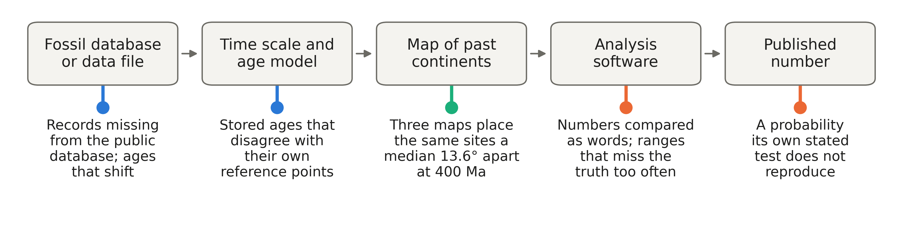

<!-- The brief's one figure, as a single image line with an empty caption and {#fig-brief width=80%},
pointing at ../figures/figB1_brief.png. It is placed at the figures div in brief.md; its one-sentence
italic caption sits in brief.md under that div. -->

{#fig-brief width=100%}
