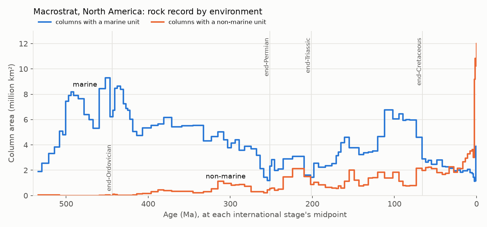

# Macrostrat

## Summary

Macrostrat is a database of the rock record. It divides the crust into
columns: polygons of crust, measured sections or drill holes. In each column
it stacks the lithostratigraphic units, with their ages, thickness,
lithology, depositional environment and links to PBDB collections. Units are
grouped into gap-bound packages, which the API calls "sections". For the
blue-sky register it offers three things:
- **B-005:** the area of North American columns with marine and with
  non-marine units through time, a rock-quantity covariate for sampled
  diversity (our inference of use).
- **B-007:** the stratigraphic architecture an architecture-only null
  needs.
- **B-008:** coarse environment classes through each crisis.

Two findings set its limits:
- **On land it is mostly North American.** Ocean drilling supplies 75% of
  units (eODP alone 69%), from holes worldwide. Of the units on land, North America holds 80%
  (27,034 of 33,611), and New Zealand, the Caribbean and South America most
  of the rest. Africa has 2 columns, Australia a one-column placeholder, and
  Europe only 7 Ediacaran columns in Svalbard.
- **Its ages are interval-derived.** In North America, 21% of the
  age-bearing Phanerozoic unit tops and bottoms fall exactly on an
  international stage boundary. Among boundaries interpolated inside an
  interval, 0.1% do (30 of 31,672), so the alignment comes from assigning
  units to intervals. Only 63 units (0.2%) carry a date from an igneous or
  ash sample, and 25 of those dates fall within the unit's age range ±5 Myr.
  The 452 other dated units carry detrital-grain spectra, which are not unit
  ages. Codex's correction to B-007, that architecture, age assignment and
  binning must be separated, applies in full.

Reach for it for the rock quantity and architecture of North America, New
Zealand, the Caribbean and South America, and for ocean-drilling
lithostratigraphy. Do not use it as a global land record or as an
independent chronology.

*Summed area of active North American columns with at least one marine
(or non-marine) unit spanning each international stage's midpoint
([series](profile/macrostrat_stage_area.tsv), drawn by
[plot_stage_area.py](plot_stage_area.py)). It is polygon area, not rock
volume. The rise into the Pleistocene comes largely from long,
undifferentiated Quaternary units: at the Gelasian, 85% of the area rests on
units spanning more than 1 Myr (review).*

## Contents

By project ([profile](profile/macrostrat_profile.tsv); project 14, "core
columns", composites the others and is left out of totals). Columns, units
and packages equal the stats route's counts for every project.

| Project | Columns (active / in process / obsolete) | Units (with ages) | Gap-bound sections | PBDB collections linked by units (fossils route) |
| --- | --- | ---: | ---: | ---: |
| 1 North America | 1,076 (949 / 6 / 121) | 27,034 (24,141) | 8,208 | 55,568 links; stats 49,266 (48,696) |
| 3 eODP (drilling holes) | 1,710 sections | 92,451 | 2,029 | 0 |
| 4 Deep Sea (drilling sites) | 133 | 7,356 | 389 | 0 |
| 5 New Zealand | 587 (329 / 258 / 0) | 2,871 (2,545) | 1,096 | 328 (328) |
| 10 North American Ediacaran | 218 | 1,372 | 648 | 0 |
| 8 South America | 61 | 1,238 (1,209) | 469 | 0 |
| 7 Caribbean | 64 | 798 | 243 | 897 (897) |
| 12 Indonesia | 25 (in process) | 212 | 64 | 0 |
| 9 Africa | 2 | 41 | 11 | 0 |
| 6 Australia | 1 (placeholder, no ages) | 32 (0) | 4 | 0 |
| 11 North American Cretaceous | 1 (no ages) | 13 (0) | 2 | 0 |
| 13 Northern Eurasia | 0 | 0 | 0 | 0 |

North American unit spans have a median of 3.6 Myr, and 13% span more than
20 Myr. By environment class, 19,471 units are marine, 3,845 non-marine, 928
both and 2,790 have none. There are 1,086,577 measurement rows. Most are
geochemistry (Ba, Cu, Fe, Cr, Sr, major oxides). Rows carry grain-age lists
joined by `|`, which expand to 1,395,765 values; the stats route reports
1,222,193 measurements. The definition tables hold 1,716 intervals, 214
lithologies, 87 environments (43 marine, 44 non-marine), 124 measurement
types, 51,225 stratigraphic names and 43,281 name concepts.

## Provenance and lineage

The Macrostrat team at the University of Wisconsin–Madison (Peters,
Czaplewski, Quinn, Husson and others) compiles columns from regional
syntheses and measured sections. Each unit is sourced in `defs/sources` and
`defs/refs`. eODP turns ocean-drilling holes into section columns, and Deep
Sea composites drilling sites. PBDB collections are matched to units by
stratigraphic name and position, which feeds the `fossils` route and the
units' PBDB counts. The API is at version 2.5.0. Nothing is versioned by
record, so each snapshot here is dated.

## Structure

- **Columns** (GeoJSON): `col_id`, polygon, `col_area` (km²), project,
  `col_type` (column or section), `status_code` (active, in process,
  obsolete), age range, and summary lithology and environment. Obsolete
  columns overlap active ones: all 121 obsolete North American columns lie
  inside active ones, and active columns alone sum to 24,810,912 km², the
  project's stated area.
- **Units** (CSV, `response=long`): `unit_id`; `section_id`, the gap-bound
  package; `col_id`; names (`Mbr`, `Fm`, `Gp`, `SGp`, `strat_name_id`);
  `t_age` and `b_age`; `t_int_name` and `b_int_name` with `t_prop` and
  `b_prop`, the position within the top and bottom intervals from 0 to 1;
  thickness; `lith`, `environ` and `econ`, each written "name type class ~
  proportion" and separated by `|`; `pbdb_collections` and
  `pbdb_occurrences`; centroid and palaeo-coordinates.
- **Sections:** gap-bound packages with age range, thickness, lithology and
  environment mixes. The route leaves some out: 1,305 of North America's
  8,208 (833 in obsolete columns, 463 active, 9 in process), and smaller
  numbers elsewhere. Derive packages from the units instead.
- **Fossils:** PBDB collections matched to units, with `pbdb_occs`. The
  route ignores `status_code` and serves no obsolete columns, so it holds
  48,696 North American collections, where the units count 49,266 (stats).
- **Measurements** (`response=long&show_values`): value or `|`-joined grain
  values, error, method, sample lithology and the unit it is tied to.
  `match_basis` is "exact" for only 243 of North America's 3,712 dated rows;
  the rest are tied by name rank, and some samples attach to several units
  (review).
- **Age models** (`age_model?col_id=`, one file per column): every unit
  boundary with its interval, relative position, modelled age and
  `boundary_status`. 284 of the 3,878 columns have no boundaries. Of the
  144,642 boundaries, 136,811 are "modeled", 7,654 "relative" and 177
  "absolute". North America has 137 absolute boundaries among 33,624, the
  North American Ediacaran 36, New Zealand 4, and the rest none. The API
  does not define the statuses; that "absolute" marks a dated boundary is
  our inference.
- **Definitions:** intervals and timescales, lithologies and attributes,
  environments, economic types, measurement types, stratigraphic names and
  concepts, sources, references, projects, column groups, drilling sites,
  minerals, structures, plates.

An empty project returns a two-byte CSV.

## Access

- **Mirror.** `deep-server:/data/paleodata/macrostrat/raw/2026-10-25T0011Z_url/`
  holds, per project, `columns__pNN.geojson`, `units__pNN.csv`,
  `sections__pNN.csv`, `fossils__pNN.csv` and `measurements__pNN.csv`, plus
  `defs__*.json`, `stats.csv` and the manifest.
  `macrostrat/age-models/raw/2026-10-25T0046Z_url/` holds
  `age_model__cNNNNN.csv`.
  [snapshots.tsv](snapshots.tsv).
- **Refresh.** [macrostrat_snapshot.sh](macrostrat_snapshot.sh) `[api]
  [agemodels]`. [macrostrat_specs.py](macrostrat_specs.py) lists the 85 api
  requests, which take about six minutes at one a second.
  [age_model_specs.py](age_model_specs.py) lists one request per column,
  3,878 in all, which take about 100 minutes. Each run is a new dated
  snapshot.
- **Profile.** `python3 macrostrat_profile.py SNAPSHOT_DIR PBDB_GLOBAL_RAW
  OUT_TSV SERIES_TSV [AGE_MODEL_DIR]` ([profiler](macrostrat_profile.py))
  writes the [profile](profile/macrostrat_profile.tsv), including the
  reconciliation with the stats route, and the
  [stage-area series](profile/macrostrat_stage_area.tsv).

## Strengths

- The standard quantitative description of the North American rock record,
  with gap-bound packages, column areas, environments and per-boundary age
  models.
- Openly licensed, with a documented API, and linked to PBDB collections.
- Ocean-drilling lithostratigraphy as continuous section columns, from eODP
  and Deep Sea.

## Weaknesses and pitfalls

- **Not global on land.** See Summary. A "global" rock-quantity curve from
  Macrostrat is a North American curve.
- **Ages are interval-derived.**
  - In North America, 9,064 of 43,381 age-bearing Phanerozoic tops and
    bottoms (21%; 0 Ma tops excluded) equal an international stage
    boundary, and 11,709 (27%) sit on an interval edge.
  - The chance baseline is 30 of 31,672 (0.1%), the share of boundaries
    interpolated inside an interval that land on a stage boundary.
  - The share falls with age: 39% in 0–2.58 Ma, 25% in 2.58–66 Ma, 28% in
    66–252 Ma and 15% in 252–539 Ma.
  - Other projects: Caribbean 39%, South America 24%, Indonesia 75%,
    North American Ediacaran 37%, New Zealand 6% (its own stages), eODP 1%.
  - Units stacked in one column share boundaries, but counting distinct
    column-age boundaries gives the same 21%.
  - B-007's architecture-only null must model age assignment separately.
- **Few unit dates.** In North America only 63 units have a date from an
  igneous or ash sample, and for 25 the sample's median lies within the
  unit's age range ±5 Myr. 452 units have only detrital-grain spectra (lists
  with a median of 86 grains, from sandstones and similar; review), which
  are provenance data, not unit ages. The age models agree: 177 of 144,642
  boundaries (0.1%) are "absolute" (Structure).
- [Detail withheld pending disclosure to the data custodian.]
  - **Lag:** elsewhere the counts differ through time, with 4,438 newer
    public occurrences and 355 counted by Macrostrat but no longer public.
    The net difference is 31,434 (361,953 against 330,519 public).
  - **Caribbean:** 215 collections (6,937 occurrences). **New Zealand:**
    107 collections (1,567 occurrences).
  - These are counts, not records, but any occurrences-per-unit covariate
    inherits them. Recount from public PBDB data under the main project's
    PBDB hold ([pbdb](../pbdb/README.md)). The units' own
    `pbdb_occurrences` was not compared. Queued for both providers
    (CONTACTS.md (queue held back) C10 (k), C34).
- **Routes that leave things out.** The fossils route skips obsolete
  columns, and the sections route skips some packages (Structure). The
  default `units?all` returns a subset (no obsolete columns), so request
  each project with every status, as the snapshot does.
- **Project 14 duplicates.** "Core columns" composites the other projects
  (39,338 units); never add it to their totals.
- **Areas need care.** Use active columns only, since obsolete ones overlap
  them. eODP holes have no area. The North American Ediacaran project's
  columns lie inside North America's (207 of 218 centroids; review), so do
  not add the two.
- **Placement errors.** 28 in-process New Zealand sections sit at latitude
  +39°, longitude 176°E. They belong at −39° (a sign error).
- **Environment is not always given.** 2,790 North American units (10%)
  have none, and the North American Ediacaran has none for 771 of 1,372.

## Overlap with other sources

- **[pbdb](../pbdb/README.md).** Macrostrat links 48,696 PBDB collections
  in North America through the fossils route (49,266 by its stats), 897 in
  the Caribbean and 328 in New Zealand. 97.5% of linked collections carry
  PBDB's current `n_occs`.
- **[timescale](../timescale/README.md).** Holds Macrostrat's interval
  table (1,716 intervals) from an earlier snapshot; the same table is in
  `defs__intervals.json`. Macrostrat prints the ICS chart's values at the
  three boundaries where PBDB now differs.
- **[asud](../asud/README.md).** That entry records 12,279 Australian names
  in Macrostrat's lexicon, imported in 2015 (source claim there), but there
  are no Australian columns.
- **[nsb](../nsb/README.md), [triton](../triton/README.md).** Ocean-drilling
  microfossil data. eODP gives the holes' lithostratigraphy for the same
  sites.

## EPRP relevance

- **B-005** (*inferred*). The rock-quantity side of "sampled diversity
  structure": active-column area with marine and non-marine units by stage
  for North America, the North American Ediacaran project and other land
  ([series](profile/macrostrat_stage_area.tsv)), with a variant using only
  units spanning 5 Myr or less. Global comparisons cannot use it.
- **B-007.** Units and gap-bound packages give the architecture. Ages are
  interval-derived and dated units are few (above). The "section and
  age-support audit with independent chronology" gate therefore has very
  little to start from:
  - 137 absolute boundaries in North America and 36 in the North American
    Ediacaran;
  - the 25 consistent igneous dates;
  - eODP's hole-based units, whose boundaries are modelled (94,611 of
    94,636).

  That is a finding for the gate: independent chronology must come from
  outside Macrostrat.
- **B-008.** Only marine and non-marine classes enter the series; refuge
  environments need the finer levels in each unit's `environ` string. North
  America, New Zealand (Late Cretaceous onward, so the K–Pg boundary) and
  the Caribbean.
- **Q-005, Q-023, Q-035, Q-041.** Stratigraphic context for completeness,
  gaps and boundary questions, with the same limits.
- Cannot support: a global land record, a chronology independent of
  interval assignments, Australia.

## Citation and terms

CC BY 4.0. Cite Peters et al. (2018) and the API with its access date (the
API's own citation is in the front matter). For individual units, cite the
sources in `defs__sources.json` and `defs__refs.json`.

## Verification log

- 2026-10-25 (Claude, Opus 5.5):
  - *checked*: snapshotted the API by project and status (85 requests). The
    profiler reconciles columns, units and packages with the stats route for
    every project. sha256 recorded and verified.
  - *checked*: fetched every column's age model (3,878 requests).
  - *checked*: profiled every project ([profile](profile/macrostrat_profile.tsv)).
    It covers the reconciliation; columns, units and spans; age support with
    a chance baseline and age bands; igneous and detrital dates;
    environments; PBDB links against our public PBDB snapshot of
    2026-10-23; measurements; age-model statuses; and the stage-area series.
  - *checked*: the New Zealand sign error (28 sections at +39°) and the 7
    Svalbard columns.
  - *source claim*: the licence, citation, API version and funding (API
    meta); project descriptions (defs/projects).
  - *inferred*: rock area as B-005's covariate; that interval assignment,
    not geology, aligns unit boundaries with stage boundaries.
  - *recall*: the 2018 paper's details beyond its DOI.
  - Independent review (Claude Sonnet subagent), findings applied:
    - dates split into igneous and detrital;
    - the stage-boundary metric's denominator, chance baseline and age
      bands;
    - the routes' omissions (fossils, sections, `units?all`);
    - the working age-model route, now mirrored;
    - PBDB counts, gross against net and lag;
    - the stage-area series (active columns, the Ediacaran project split
      out, resolution);
    - coverage wording.
    Figures marked "(review)" come from the review's scripts.
